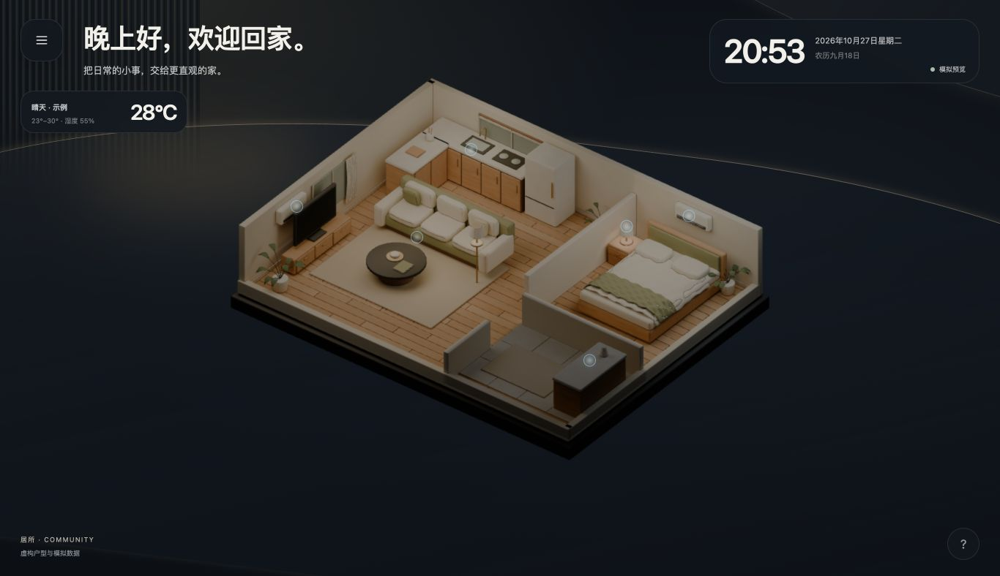
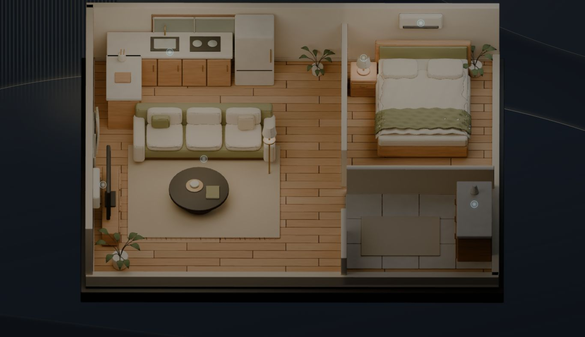
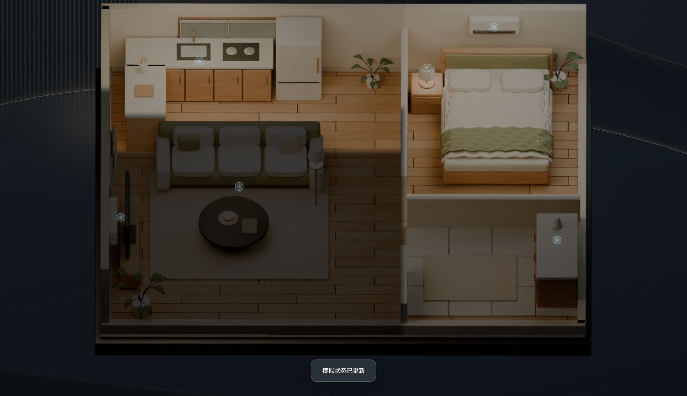
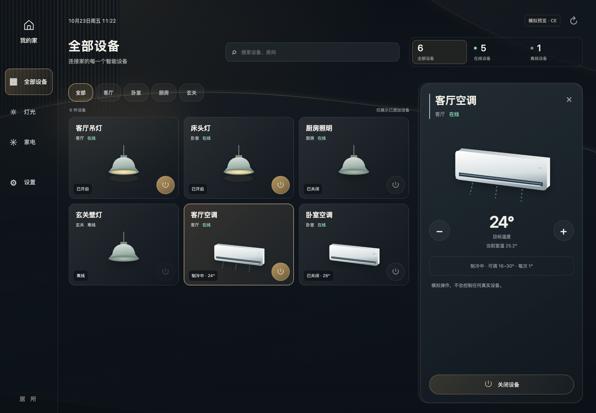
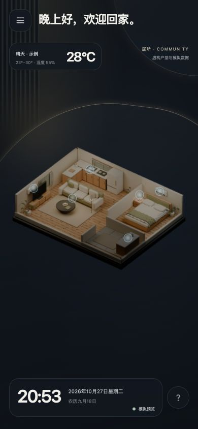
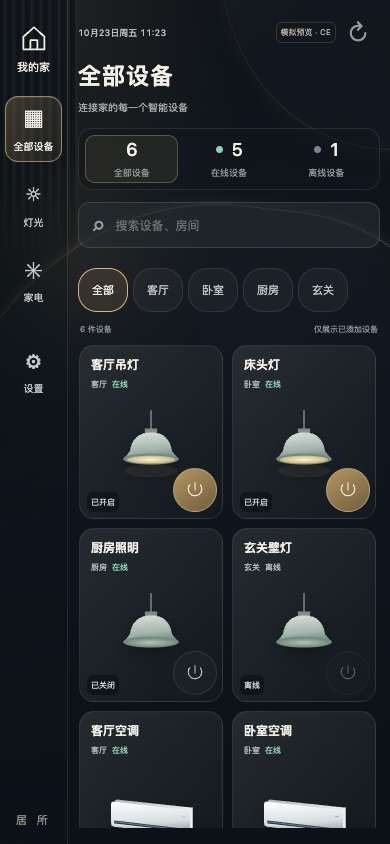
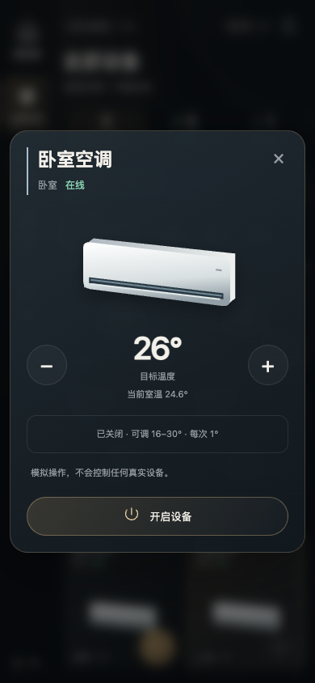

<!-- SPDX-License-Identifier: MPL-2.0 -->
# 居所 · Community Edition

**把 Home Assistant 的基础设备控制，放进一个更直观的家。**

> 当前为早期预览版 `0.1.0-preview.3`，采用 MPL-2.0。默认使用虚构家庭，不需要账号、令牌或真实设备。真实 HA、Windows 和实体 iPad 兼容性仍待验证。

从抖音 / 小红书过来？先记住三件事：

- **这是什么：** 居所是运行在 Home Assistant 之外的独立网页界面，不是一个 HA 主题，也不是 HACS 插件。
- **能做什么：** 看设备状态、按房间找设备、开关灯、调整空调目标温度。首页还有一个可旋转的虚构 3D 小家。
- **怎么开始：** 先启动模拟家庭，喜欢这个体验，再接入自己的 HA。无需安装 AI 模型。

## 先看看效果

以下截图均来自社区版虚构家庭，不含真实户型与家庭数据。



放大检查高光细节与关灯效果：



同一放大视角关闭客厅灯：客厅变暗，卧室与厨房维持原状态。



<details><summary>设备页、手机与设备详情</summary>









</details>

### 演示视频

视频待录制，当前没有可播放链接。建议首条视频用 30–60 秒展示：打开首页 → 旋转空间 → 开关灯 → 调温 → 切换房间 → 说明 CE 范围。只录虚构家庭，遮住浏览器个人信息；以后把视频链接放在这里。

## 功能与范围

| 功能 | 当前社区版 |
| --- | --- |
| 空间首页 / 全部设备 / 设置 | 恢复原版布局与视觉，适配电脑与手机 |
| 3D 空间 | 暖木、米白与橄榄绿的虚构公寓；软包家具、床品褶皱、木纹 / 布纹和烘焙暖光；缓慢自动旋转、拖动 / 缩放、双击与闲置复位；不包含真实户型 |
| 灯光 | 开关、在线状态、操作后回读 |
| 空调 | 开关、目标温度、当前温度；受设备能力限制 |
| 房间筛选 / 搜索 / 详情 | 可体验 |
| 模拟家庭 | 开箱可用，重启后还原 |
| 自己的 HA | 提供最小适配器和配置教程；需自己配置，尚未完成真实设备验收 |
| 添加到主屏幕 | 提供 Web App Manifest；具体安装入口取决于浏览器，不提供离线设备控制 |
| 完整 AI / 语音 / 家庭记忆 | 不包含 |
| 真实户型 / 摄像头 / 车辆 / 私人自动化 | 不包含 |

**CE 与完整方案的区别：** CE 是能安装、看懂、学习和二次开发的基础版本。完整私人方案包含更深的家庭适配和 AI 能力，并不是安装 CE 后解锁一个开关就能获得。[查看详细范围](docs/community-vs-full.md)。

## 3 步启动模拟家庭

需要 Node.js **24.x**。本版没有 npm 生产依赖，不需要先运行 `npm install`，也不需要 HA。

1. 打开[项目仓库](https://github.com/wangjie0713/jusuo-community)，选择 **Code → Download ZIP** 并解压；也可以使用作者提供的社区版文件夹。仓库在公开前仅对获授权的账号可见。
2. 在这个文件夹打开终端。先输入 `node --version`，显示 `v24...` 后运行：

   ```sh
   npm start
   ```

3. 浏览器打开 **http://127.0.0.1:4177**。看到首页时钟区的“模拟预览”就成功了。

终端会保持运行，这是正常的；结束体验时在该终端按 `Ctrl+C`。默认只供当前电脑访问。不要直接双击 `index.html`。

[不会打开终端？按图式步骤看入门教程](docs/getting-started.md) · [想接入自己的设备？看配置教程](docs/configuration.md)

## 原版交互怎么用

- 首页静置约 6 秒后，房子开始缓慢自动旋转（约 5 分钟一圈）；点击左上角菜单进入全部设备。
- 鼠标拖动或滚轮、触屏双指缩放进入模型浏览，信息层淡出。双击模型复位，停止操作 10 秒后也会复位。
- 默认视角下，触屏左滑进入设备页、右滑回首页；模型浏览时单指用于旋转。没有底部页签。
- 设备卡片主区域打开详情，独立电源按钮才执行控制。电脑右侧常驻详情，小屏弹出详情。
- 长按卡片移动排序，只保存到此浏览器；键盘可聚焦卡片后按 Alt + 左右方向键。
- 切到设备页、打开浮层、页面进入后台或系统启用“减少动态效果”时，自动旋转暂停。

首页天气明确标注“示例”，不定位、不查询真实天气。真实 HA 模式显示天气未接入，不把演示天气当成家庭实况。

精细模型随候选包提供，普通使用不需要 Blender。模型或纹理加载失败时仍可使用基础模型和设备页；[模型说明与二次开发方法](docs/model-customization.md)。

## 常见问题

**必须有 Home Assistant 吗？** 体验模拟家庭不需要。控制真实设备需要你已有可正常工作的 HA。

**为什么没有我的设备、户型或 AI？** 当前是基础社区版。它保留居所原版的全屏空间、悬浮天气与时钟、设备第二页、窄侧栏及详情交互；它只加载显式配置的灯和空调，不会自动搬入作者家庭，也不扫描你的全部家庭设备。

**3D 会自动变成我家吗？** 不会。虚构模型可供学习；真实模式仍显示明确标注的示意空间，与实际设备不联动。

**运行命令后打不开？** 保持终端打开，检查是否显示启动地址。端口占用、Node 版本和网络问题见[排障步骤](docs/getting-started.md#排障)。

**可以用 iPad / Windows 吗？** UI 已检查手机尺寸的浏览器布局；真实 iPad、Windows 主机和真实 HA 尚未验收，不把本机浏览器测试当成这些平台验证。

**它会上传我家的数据吗？** 当前代码没有统计、广告、云端 AI 或遥测。模拟模式仅本机通信。真实模式由服务端连接你配置的本地 HA，令牌不会下发前端。仍须妥善保护本机配置和访问密码。

**可以二次开发和商用吗？** 可以，需遵守 [MPL-2.0](LICENSE)。向他人分发修改版时，应按条款提供受许可约束部分的源码；独立且不含 MPL 代码的文件可以使用其他许可。社区版不包含完整私人方案，详见[授权说明](docs/license-decision.md)。

## 遇到问题怎么办

先看[排障](docs/getting-started.md#排障)。在[项目 Issues](https://github.com/wangjie0713/jusuo-community/issues) → **New issue** 选择错误反馈或功能建议，填写系统、版本、重现步骤和预期效果。不要发送 `.env`、真实 `entity_id`、家庭地址或设备截图原图。安全问题按 [SECURITY.md](SECURITY.md) 私下反馈。

## Roadmap

- [x] 独立模拟家庭、基础控制 UI、房间筛选、虚构空间。
- [x] 恢复原版空间首页 / 设备页风格，自动旋转、双击与闲置复位、触屏双页和本机排序。
- [x] 服务端最小 HA 适配、认证、白名单、状态回读与模拟测试。
- [x] 作者本地审阅视觉与交互。
- [ ] 用测试设备完成真实 HA、Windows、iPad 验收和兼容性记录。
- [x] 确认 MPL-2.0，提供授权声明和仅含允许文件的导出流程。
- [ ] 完成 GitHub 上传、仓库检查与公开发布。
- [ ] 录制虚构家庭演示视频。
- [ ] 改善配置向导和更多基础设备类型；依据实际反馈排优先级。

没有承诺开放完整私人 AI、真实家庭配置或全部商业方案。

## 想研究源码

```text
public/                页面、虚构空间、第三方渲染库
server/                会话、安全控制、demo / HA 适配器
config/                只含虚构映射示例
deploy/                环境变量示例、可选容器模板
docs/                  安装、配置、范围、首次 GitHub 发布教程
assets/screenshots/    虚构家庭截图
tests/                 不连接真实设备的测试
scripts/               检查与白名单打包
.github/               Issue / PR 模板与检查工作流
```

运行 `npm test`、`npm run check`。开发约定见 [CONTRIBUTING.md](CONTRIBUTING.md)。Node 服务直接提供源码文件，不需要前端构建。

## 给第一次发布项目的作者

从[第一次发布指南](docs/first-github-publish.md)开始：生成上传文件夹 → 上传新私有仓库 → 检查下载与运行 → 再决定公开。上传材料由白名单生成；不要上传原正式项目、审计目录或把原私人仓库改成公开。

## License 与来源

本项目自有代码、文档、示例与虚构素材采用 [MPL-2.0](LICENSE)，适用范围见 [NOTICE.md](NOTICE.md) 与[授权说明](docs/license-decision.md)。第三方 Three.js 及配套模块保留原 MIT 声明，见 [THIRD_PARTY_NOTICES.md](THIRD_PARTY_NOTICES.md)。本项目不是 Home Assistant 官方产品。
